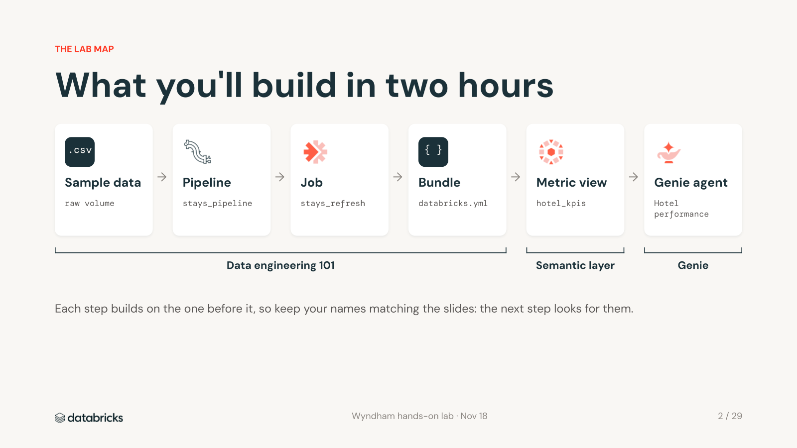
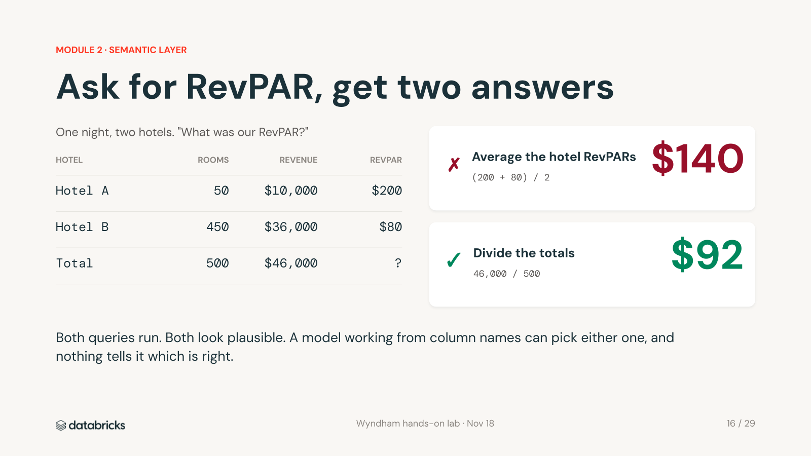
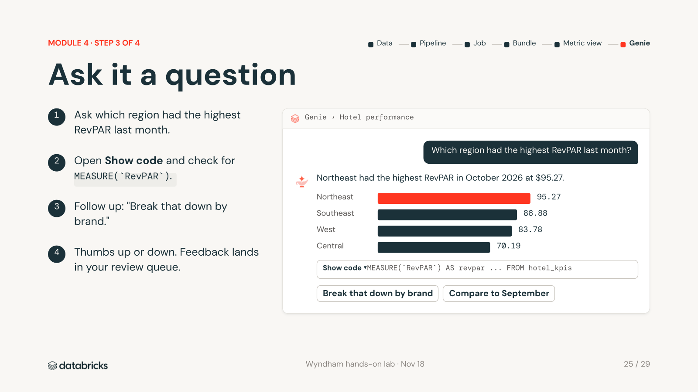
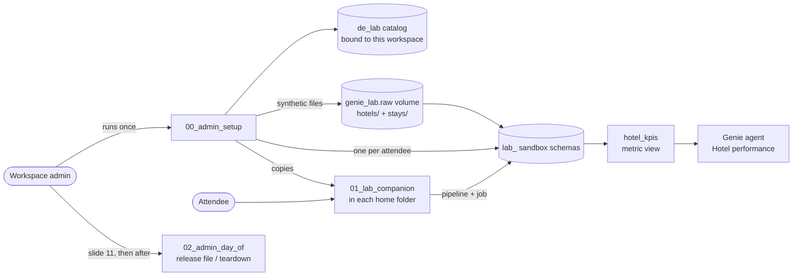

<p align="center">
  
</p>

<h1 align="center">From raw data to a Genie agent</h1>

<p align="center">
  <b>A two-hour, hands-on Databricks lab: build a pipeline, schedule it, define RevPAR once in a metric view, and leave with a working Genie agent.</b><br>
  Three notebooks: one admin setup, one attendee companion, one for day-of and teardown. Synthetic data, least privilege, serverless only.
</p>

<p align="center">
  
  
  
  
  
</p>

<p align="center">
  
</p>

---

## ✨ What it does

| | Module | What attendees build |
|---|---|---|
| 🧰 | **0 · Setup** (10 min) | Find the shared sample data and their own sandbox schema. |
| 🏗️ | **1 · Data engineering 101** (45 min) | `stays_pipeline`: bronze streaming table from raw JSON, silver with typed columns and expectations, gold `gold_hotel_daily` at one row per hotel per night. Then `stays_refresh`, a job with a file arrival trigger, a SQL freshness check and failure email, shipped as a bundle. |
| 🧮 | **2 · Why a semantic layer** (10 min) | See on real rows why averaging hotel RevPARs gives the wrong portfolio number. |
| 📐 | **3 · Metric views** (20 min) | `hotel_kpis`: RevPAR, ADR and occupancy defined once in YAML, queried with `MEASURE()`. |
| 🧞 | **4 · Genie** (25 min) | A **Hotel performance** agent on the metric view, with instructions, sample questions, example SQL and benchmarks checked against a computed answer key. |

<table>
  <tr>
    <td width="50%"></td>
    <td width="50%"></td>
  </tr>
  <tr>
    <td align="center"><sub>Module 2: the same question, two plausible SQL answers</sub></td>
    <td align="center"><sub>Module 4: Genie answers from the metric view with <code>MEASURE(`RevPAR`)</code></sub></td>
  </tr>
</table>

## 🏗️ How it works



- **Everything lives in one lab catalog** bound to a single workspace, so it isn't reachable from any other workspace on the metastore. Teardown drops it.
- **Attendees write only to their own schema** and own what they create, so no extra grants are needed for pipelines, jobs, metric views or Genie.
- **The setup reuses an existing SQL warehouse** (the Starter warehouse by default) and only adds `CAN USE` for the group. Nothing creates or deletes compute.

## 🚀 Quick start

> [!NOTE]
> **You need a workspace admin** who also has `CREATE CATALOG` on the metastore, plus an **account-level group** (default `de-lab-users`) with the attendees in it, assigned to the workspace. Serverless compute and partner-powered AI features (for Genie) must be on.

### 👩‍💼 For the admin: before the lab

1. **Clone the repo** into the workspace: **Workspace → Create → Git folder**, URL `https://github.com/jonathan-whiteley/wyndham-de-lab`. It's public, so no Git credentials are needed. (Or download the three `.py` files and **Import** them into one folder.)
2. **Open `00_admin_setup`**, attach **Serverless**, review the widgets (see [settings](#-deploy-to-your-own-workspace-catalog-and-schema)), and **Run all**. It takes about 2 minutes.
3. **Read the preflight output.** It lists every attendee and the schema they'll get. Fix anything flagged with `!`.
4. **Dry run.** Have one attendee open `/Users/<them>/de-lab/01_lab_companion` and run Module 0.

Someone added late? Add them to the group and **rerun setup**. It's idempotent and never overwrites an attendee's existing notebook.

### 🧑‍💻 For attendees: during the lab

1. **Open** `de-lab/01_lab_companion` in your home folder and attach **Serverless**.
2. **Run the first cell.** It prints your schema, the sample data path and the SQL warehouse to use.
3. **Follow the slides.** Each module prints the code to paste (with your names filled in) and checks your work.

### 🎬 On the day, and after

| When | Run `02_admin_day_of` with `action` = | What happens |
|---|---|---|
| Slide 11 | `release_holdback` | Moves the held-back night into `stays/`. Every attendee's file arrival trigger fires and their pipeline reads only the new file. |
| After the lab | `teardown` | Deletes lab jobs and pipelines, trashes Genie agents built on the lab catalog, drops the catalog. Leaves the warehouse and attendee notebooks alone. |

With the default `action = none`, the notebook changes nothing.

## 🔧 Deploy to your own workspace, catalog and schema

> [!IMPORTANT]
> **Everything workspace-specific is a widget at the top of `00_admin_setup`.** Setup writes the catalog and warehouse names into each attendee's copy of the companion, so attendees never edit anything.

| Setting | Notebook | What to set | Default |
|---|---|---|---|
| `catalog` | `00`, `02` | Lab catalog to create, then drop | `de_lab` |
| `group` | `00` | Account-level attendee group | `de-lab-users` |
| `managed_location` | `00` | Catalog storage path, if the metastore has no root storage or policy requires one | blank |
| `warehouse_name` | `00` | Existing SQL warehouse to use (Pro or serverless, Current channel) | blank: the one named "Starter" |
| `companion_path` | `00` | Where `01_lab_companion` lives | blank: same folder |
| `end_date` | `00` | Last stay night, held back for the live demo | `2026-11-17` |
| `peer_sharing` | `00` | Let attendees share their metric view with each other | `yes` |
| `action` | `02` | `none`, `release_holdback` or `teardown` | `none` |

### Privileges

| Who | Needs | Why |
|---|---|---|
| **The admin running setup** | Workspace admin, `CREATE CATALOG` on the metastore | Creates the catalog, binds it, applies grants, copies notebooks |
| **The attendee group** | Workspace access and Databricks SQL access entitlements (no cluster creation) | Notebooks, pipelines and jobs; SQL editor and Genie |
| | `USE CATALOG` on the lab catalog; `USE SCHEMA` on `genie_lab` | Reach the shared sample data |
| | `READ VOLUME` on `genie_lab.raw` | `read_files` in the pipeline, file arrival trigger |
| | `SELECT` on `genie_lab.gold_hotel_daily` | Read-only catch-up table if a pipeline isn't finished |
| | `CAN USE` on the SQL warehouse | SQL editor, the job's SQL task, metric views, Genie |
| | `USE SCHEMA` on every `lab_<user>` schema (only if `peer_sharing`) | Lets the "share it" step work; no data is visible without the owner's `SELECT` |
| **Each attendee** | `USE SCHEMA`, `CREATE TABLE`, `CREATE MATERIALIZED VIEW` on their own `lab_<user>` | Streaming tables, materialized views and the metric view |

Nobody gets `CREATE CATALOG`, `CREATE SCHEMA`, external locations, `MODIFY` on shared data, or access to any other catalog.

> [!TIP]
> **Can't create catalogs?** Ask a metastore admin to create the catalog and make you its owner, then run setup with that name in the `catalog` widget. `CREATE CATALOG IF NOT EXISTS` skips the create step.

## 📁 Project structure

```
.
├── 00_admin_setup.py     👈 admin runs once; all settings are widgets at the top
├── 01_lab_companion.py   attendee notebook, copied to each home folder by setup
├── 02_admin_day_of.py    release the held-back file (slide 11) and teardown
└── docs/
    └── images/           README images (slides from the lab deck)
```

## 🩺 Troubleshooting

| Symptom | Fix |
|---|---|
| **`is not a workspace admin`** | Run setup as a workspace admin. |
| **`is a workspace-local group`** | Unity Catalog grants need an account-level group. Create it in the account console (or sync it from your IdP) and assign it to the workspace. |
| **`Expected exactly one matching warehouse`** | Set the `warehouse_name` widget to the exact warehouse name. |
| **`Could not set the workspace binding automatically`** | In Catalog Explorer, open the catalog, go to **Workspaces**, and uncheck **All workspaces have access**. |
| **`PERMISSION_DENIED` on `CREATE CATALOG`** | Get `CREATE CATALOG` on the metastore, or set `managed_location` if the metastore has no root storage. See the tip above. |
| **Attendee sees a permissions error in Module 0** | They weren't in the group when setup ran. Add them and rerun setup. |
| **`Stays data is stale`** in the freshness check | The newest night is more than 3 days old. Rerun setup with a later `end_date`, or release the held-back file. |
| **Metric view create fails on syntax** | The warehouse or compute must be on Databricks Runtime 17.3+. Use serverless, or a warehouse on the Current channel. |
| **File arrival trigger doesn't fire** | Wait about a minute after release. The job owner needs `READ VOLUME` (granted by setup). A workspace allows 50 jobs with file arrival triggers on storage without file events. |
| **Genie's Show code doesn't use `MEASURE()`** | Add **only** `hotel_kpis` as the agent's data. Leave the bronze, silver and gold tables out. |
| **Genie counts weekends as Saturday and Sunday** | Expected, that's the benchmark lesson. Add the instruction "Weekend nights are Friday and Saturday" and rerun. |

## 🗂️ About the data

All data is **synthetic**, generated by `00_admin_setup`: 48 hotels across four regions and Wyndham brands, and one JSON file per night from Oct 1 with one row per room night sold (about 210K rows). There are no guests and no PII, so it's safe for lower environments. Every stay field lands as a string on purpose, so typing the data is part of the silver step. The data includes some planted stories:

- **Bad rows for the expectations:** about 0.4% of rows have a zero or negative `room_rate`, and about 0.2% have a null `hotel_id`.
- **Shapes that match the slides:** Northeast leads on RevPAR (about $95 in October), and Friday and Saturday nights run hotter.
- **One held-back night** (`end_date`) for the live incremental demo.

None of it is Wyndham's real data.

---

<p align="center">Made with ❤️ by Jonathan Whiteley at Databricks</p>
